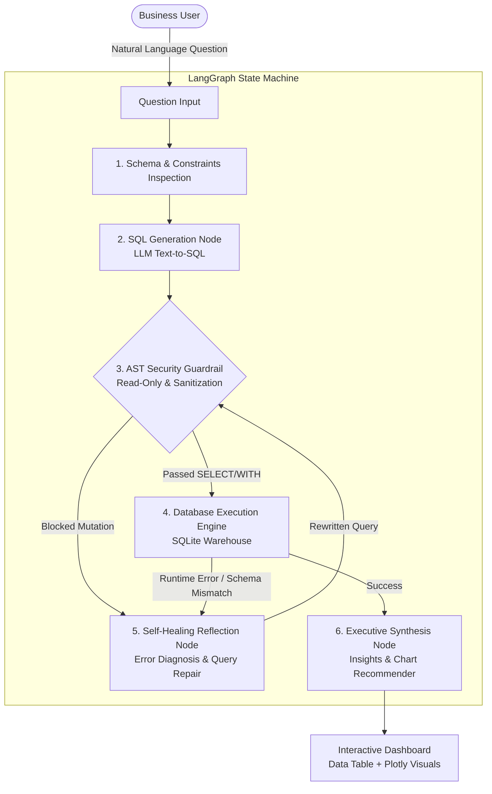

# InsightSQL ⚡
### Autonomous Self-Healing Business Intelligence & Text-to-SQL Engine

[](https://www.python.org/downloads/)
[](https://github.com/langchain-ai/langgraph)
[](https://streamlit.io/)
[](https://opensource.org/licenses/MIT)
[](https://www.docker.com/)

**InsightSQL** is an enterprise-grade autonomous Text-to-SQL and business intelligence engine built with **LangGraph**. It translates natural language questions into complex analytical SQL queries (CTEs, Window Functions, Multi-Table Joins), enforces strict AST-level read-only security guardrails, and incorporates an **autonomous self-healing reflection loop** that detects, diagnoses, and repairs database execution errors without human intervention.

---

## 🏛️ System Architecture



---

## 🚀 Key Engineering Highlights

- **LangGraph StateGraph Execution Pipeline**: Designed as a directed cyclic graph with stateful schema propagation, conditional execution edges, and bounded retry loops.
- **Autonomous Self-Healing Reflection Loop**: When SQL execution fails (e.g. unknown column, missing join, type mismatch), the engine analyzes the database dialect error trace and schema constraints to autonomously rewrite and repair the query.
- **AST-Level Read-Only Security Guardrails**: Strict regex and AST validation blocks SQL injection, semicolon chaining (`;`), and destructive operations (`DROP`, `DELETE`, `UPDATE`, `ALTER`, `TRUNCATE`, `PRAGMA`), enforcing strict `SELECT` or `WITH` queries with auto-injected `LIMIT` bounds.
- **Automated Business Intelligence & Plotly Visualizations**: Synthesizes tabular data into 3-bullet executive takeaways and dynamically plots interactive bar or line charts based on result metadata.
- **Dynamic Multi-Provider Routing**: Seamlessly runs on **Groq** (`openai/gpt-oss-120b`, `qwen/qwen3.8-27b`), **OpenRouter** (`cohere/north-mini-code`, `nvidia/nemotron-3.5-lightning`), **OpenAI**, or local proxy endpoints.

---

## 📊 25-Query Autonomous Benchmark Suite

The engine was evaluated on a comprehensive 25-query analytical benchmark suite across multi-table schemas (`customers`, `orders`, `order_items`, `products`, `returns`) covering aggregations, multi-table joins, subqueries, and window functions.

### **Performance Summary**

| Metric | Result |
| :--- | :--- |
| **Total Benchmark Queries** | **25 / 25** |
| **Overall Execution Success Rate** | **100.0%** |
| **First-Pass Translation Accuracy** | **96.0% (24 / 25)** |
| **Autonomous Self-Healing Recovery Rate** | **4.0% (1 / 25)** |
| **Unrecoverable Engine Failures** | **0.0% (0 / 25)** |
| **Latency (P50)** | **1.81s** |
| **Latency (P95)** | **8.29s** |
| **Latency (Average)** | **3.98s** |

> *Full benchmark logs and JSON telemetry available in [`benchmark_results/benchmark_run.json`](benchmark_results/benchmark_run.json).*

### **Evaluation Query Categories**
1. **Basic Aggregations & Filters**: Counts, active customer ratios, pre/post-discount sums.
2. **Category & Dimension Aggregations**: Net revenue by category, geographic order volume, tier distributions.
3. **Multi-Table Relational Joins**: Top spenders, never-ordered inventory, return loss by return reason.
4. **Complex Business Logic & Window Functions**: Average Order Value (AOV), monthly revenue trends, return rates by quantity, customer churn ranking via `RANK() OVER`.

---

## 🛠️ Quickstart Guide

### 1. Clone & Set Up Environment
```bash
git clone https://github.com/Parth231103/insight-sql.git
cd insight-sql
python -m venv venv
# Windows:
venv\Scripts\activate
# Linux/macOS:
source venv/bin/activate
pip install -r requirements.txt
```

### 2. Configure API Keys
Copy `.env.example` to `.env` and set your preferred provider:
```bash
cp .env.example .env
```
Example `.env`:
```env
# Groq (Recommended for sub-second latency)
GROQ_API_KEY=your_groq_api_key_here
GROQ_MODEL=openai/gpt-oss-120b

# Or OpenRouter
# OPENROUTER_API_KEY=your_openrouter_api_key_here
# OPENROUTER_MODEL=cohere/north-mini-code:free
```

### 3. Launch the Streamlit App
```bash
streamlit run app.py
```
Open your browser at `http://localhost:8501`.

### 4. Run the 25-Query Benchmark
```bash
python scripts/benchmark.py
```

---

## 🐳 Docker Deployment

Run the complete application with Docker Compose:
```bash
docker-compose up --build
```
Access the application at `http://localhost:8501`.

---

## 📂 Project Structure

```
insight-sql/
├── app.py                     # Streamlit BI dashboard & chart visualizer
├── config.py                  # Dynamic LLM routing (Groq, OpenRouter, OpenAI)
├── db.py                      # SQLite warehouse generator & schema introspector
├── graph.py                   # LangGraph StateGraph with self-healing reflection
├── security.py                # AST & regex read-only guardrails
├── scripts/
│   └── benchmark.py           # 25-query autonomous benchmark harness
├── benchmark_results/
│   └── benchmark_run.json     # Benchmark telemetry & performance metrics
├── requirements.txt           # Python dependencies
├── Dockerfile                 # Container specification
├── docker-compose.yml         # Container orchestration
└── README.md                  # Project documentation & architecture
```

---

## 🛡️ License
Distributed under the MIT License. See `LICENSE` for details.
